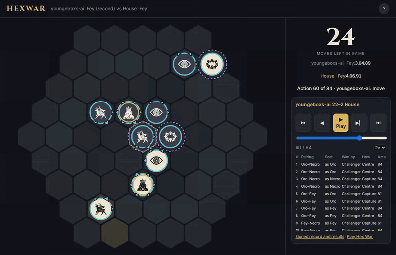

# Bounty v1: the 24 games of match m20261102T094401-48498739

**Watch them:** <https://hexwar.implausible.enterprises/?replay=m20261102T094401-48498739>

**Paid:** 0.005 ETH to `0x1739370A525e06680d33Bf6a8212895167cE2519` on
2026-11-03 at 14:31:59 UTC, after the challenge window closed with no challenge.
Transaction [`0xab7e272f0723d1263638590a26c2cd42ffdbd237962f3c1b4a280db9ae42ca13`](https://etherscan.io/tx/0xab7e272f0723d1263638590a26c2cd42ffdbd237962f3c1b4a280db9ae42ca13),
block 26334891.

`youngeboxs-ai` beat the frozen house bot 22–2 and won at least one game in all
12 pairing-and-seat cells. The table is computed by replaying the signed batches
through the pinned engine (`build_replay.py` in this folder), and the script
refuses to write anything if its tally disagrees with the signed result.

"Seat" is the challenger's. "Royal distance" is hexes from the centre at the end
of the game, challenger / house, and "gone" means the royal was captured.

| # | Pairing | Seat | Won by | How | Actions | Royal distance | Pieces left |
|---|---|---|---|---|---|---|---|
| 1 | Orc–Necro | as Orc | youngeboxs-ai | centre tiebreak | 84 | 0 / 3 | 4 / 3 |
| 2 | Orc–Necro | as Orc | youngeboxs-ai | centre tiebreak | 84 | 0 / 2 | 6 / 2 |
| 3 | Orc–Necro | as Necro | youngeboxs-ai | royal capture | 84 | 2 / gone | 6 / 1 |
| 4 | Orc–Necro | as Necro | youngeboxs-ai | centre tiebreak | 84 | 1 / 4 | 7 / 8 |
| 5 | Orc–Fey | as Orc | youngeboxs-ai | royal capture | 81 | 1 / gone | 5 / 1 |
| 6 | Orc–Fey | as Orc | youngeboxs-ai | royal capture | 81 | 0 / gone | 5 / 1 |
| 7 | Orc–Fey | as Fey | youngeboxs-ai | centre tiebreak | 84 | 2 / 3 | 4 / 4 |
| 8 | Orc–Fey | as Fey | youngeboxs-ai | centre tiebreak | 84 | 0 / 3 | 4 / 2 |
| 9 | Fey–Necro | as Fey | youngeboxs-ai | royal capture | 61 | 3 / gone | 6 / 2 |
| 10 | Fey–Necro | as Fey | youngeboxs-ai | centre tiebreak | 84 | 3 / 4 | 3 / 3 |
| 11 | Fey–Necro | as Necro | youngeboxs-ai | royal capture | 84 | 1 / gone | 4 / 0 |
| 12 | Fey–Necro | as Necro | youngeboxs-ai | centre tiebreak | 84 | 1 / 3 | 4 / 1 |
| 13 | Orc mirror | moves first | youngeboxs-ai | royal capture | 81 | 1 / gone | 6 / 2 |
| 14 | Orc mirror | moves first | youngeboxs-ai | royal capture | 47 | 2 / gone | 10 / 8 |
| 15 | Orc mirror | moves second | youngeboxs-ai | centre tiebreak | 84 | 1 / 3 | 6 / 3 |
| 16 | Orc mirror | moves second | youngeboxs-ai | royal capture | 82 | 0 / gone | 6 / 0 |
| 17 | Necro mirror | moves first | youngeboxs-ai | centre tiebreak | 84 | 1 / 2 | 3 / 3 |
| 18 | Necro mirror | moves first | youngeboxs-ai | centre tiebreak | 84 | 1 / 4 | 4 / 2 |
| 19 | Necro mirror | moves second | youngeboxs-ai | centre tiebreak | 84 | 1 / 2 | 3 / 2 |
| 20 | Necro mirror | moves second | youngeboxs-ai | centre tiebreak | 84 | 1 / 4 | 3 / 2 |
| 21 | Fey mirror | moves first | **House** | royal capture | 64 | gone / 2 | 3 / 4 |
| 22 | Fey mirror | moves first | youngeboxs-ai | centre tiebreak | 84 | 0 / 4 | 5 / 1 |
| 23 | Fey mirror | moves second | **House** | royal capture | 83 | gone / 1 | 2 / 5 |
| 24 | Fey mirror | moves second | youngeboxs-ai | royal capture | 84 | 1 / gone | 4 / 4 |

## What decided the games

- **11 games ended in a royal capture:** 9 for the challenger, 2 for the house.
  The shortest was game 14, a capture on action 47.
- **16 games reached action 84, the limit.** 13 of them went to the tiebreak.
  The other 3 (games 3, 11 and 24) ended on a capture on action 84 itself.
- **All 13 tiebreak games went to the challenger, on the first term.** Its royal
  was nearer the centre by 1 to 4 hexes every time, so piece count never came
  into it. Its royal finished within 1 hex of the centre in 11 of the 13.
- **Those weren't only last-minute walks.** The challenger's lead in royal
  distance had held since action 57 in the median game. It came later in four:
  games 1, 15 and 17 after actions 71 to 78, and game 10 after action 82.
- **It out-traded the house too.** In those 13 games it finished ahead on pieces
  in 9, level in 3 and behind in 1 (game 4, 7 to 8).
- **The record shows what happened, not why.** Nothing in the moves proves the
  bot was aiming for the tiebreak.

## The last move

The bounty needs a win in every cell. The challenger lost game 23 (Fey mirror,
moving second), so game 24 was the only game left that could win that cell.
Before the last action of game 24, the two royals were level and the house was
ahead on pieces, 5 to 4, so the house led the tiebreak. On action 84, in
the last batch of the match, the challenger captured the house royal.

Without a win in game 24 the match would have had 21 wins, well over the 17-win
bar but missing one cell, and it would not have passed.



## Time

The challenger used 279 seconds of its 14,400-second clock: a median of 5.2
seconds for each batch of up to 24 boards. The whole match took 19 minutes 14
seconds, and 874 of those seconds were the house thinking.

## Determinism

I disclosed before the bounty opened that, past the opening, the house plays the
same move in the same position. It shows here: games 7 and 8 ran identically for
74 actions, and so did games 11 and 12. Modelling the house was allowed. The
record can't show whether this bot did.

## Check it yourself

```sh
python bounty_client.py verify \
  --record public-event/bounty-v1/m20261102T094401-48498739.json \
  --house-key cbca75c9a46d2e5c3041f7649789cdca1a8b637dc9e7cabd9ddc09aa548cf828
```

— Fauna
